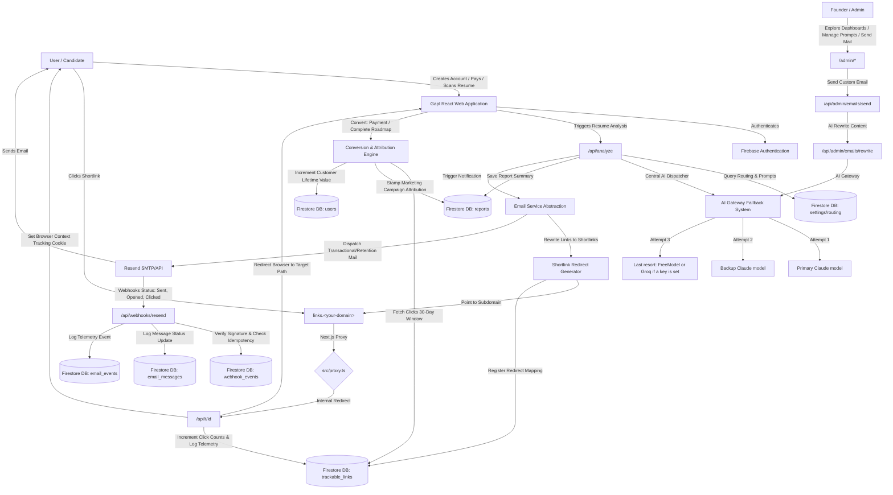

# Gapl

An application-readiness tool for job seekers, with an email and attribution back office for the founder. A candidate uploads a resume (PDF or text) and a job description; Gapl scores the fit, lists the gaps, builds a learning roadmap and helps rewrite the CV. Built solo by [Deepanshu Lathar](https://deepanshulathar.com).

[Live app](https://gapl.vercel.app) | [Project status](PROJECT_STATUS.md) | [Report an issue](https://github.com/latharrr/gapl/issues)


| At a glance | |
|---|---|
| **Status** | Live beta with about 10 early users, mostly friends. Not a production launch ([details](PROJECT_STATUS.md)) |
| **Stack** | Next.js (App Router), TypeScript, Firebase Auth + Firestore, Resend, Razorpay, Tailwind + Radix UI |
| **AI** | One gateway in `src/lib/ai-gateway.ts` with a primary model, a backup and optional last-resort fallbacks. The models named in the source are Anthropic Claude; which one a deployment runs depends on its keys and settings |
| **Tests** | 14 unit tests (credits, payments, report-ready scores); CI runs lint, typecheck, tests and a production build |
| **My role** | Product, UI, backend, AI routing, email and attribution pipeline, admin tooling |

## What a candidate gets

1. **Resume and JD analysis.** Reads a PDF or pasted text, compares it with the job description and returns a readiness score, ATS fit, strongest signals and weaknesses for a chosen role and company tier.
2. **CV builder.** AI bullet rewrites, keyword suggestions, single-page print layout and "email me this".
3. **Roadmap.** Missing skills sorted by priority, with weekly project milestones. Progress emails go out at 25, 50, 75 and 100 percent.

## What is interesting in the code

- **AI gateway** (`src/lib/ai-gateway.ts`): one entry point for every user-facing AI task. In the current source it tries a primary Claude model, falls back to a second Claude model, and uses FreeModel or Groq only if both fail and a key is configured. Each call records tokens and cost.
- **Email attribution.** Links in emails are rewritten to a tracking subdomain. A proxy (`src/proxy.ts`) turns each click into a logged redirect, and a payment or finished report is credited to the last email click in the previous 30 days.
- **Webhook handling.** Resend webhooks are signature-verified and de-duplicated by event ID before anything is written; Razorpay webhooks are signature-verified.
- **Rate limits** are stored in Firestore so they hold across serverless instances, with an in-memory fallback when the store is down.
- **Admin back office** (`/admin`) with role-based access (`super_admin`, `admin`, `support`, `readonly`): email health, shortlinks, alerts, payments and refunds, audit log.

## Quick start

Needs Node 22 (as in CI) and a Firebase project.

```bash
npm install
# create .env.local with the variables listed under "Local development setup" below
npm run dev          # http://localhost:3000
npm test             # node --test tests/*.test.mjs
npm run lint
npm run build
```

## Known limitations

- A paid flow with a real card, load behaviour, analysis accuracy and AI cost per analysis have not been measured. No scale claim is made.
- Output quality depends on which model answers, and every analysis costs API money.
- No license file yet.

The sections below are the detailed reference: architecture, data model, API, admin tools and configuration.

## System Architecture & Data Flow




## Core Product Capabilities

### 1. Resume Parsing & Job Description (JD) Analysis
* **Multi-Format Extraction**: Parses text from PDF uploads, text blocks, and manual copies.
* **Competency Matching**: Compares applicant skills against specialized JDs to identify gaps.
* **Role & Company Tier Profiling**: Matches resumes against target roles (*SDE, Frontend, Backend, DevOps, ML, Product Manager*) and company tiers (*FAANG, Series A-C Startups, Mass Recruiters*).
* **Recruiter Verdict Simulator**: Simulates the screening processes of hiring managers, assigning an overall readiness score, ATS fit rating, strongest resume signals, and weakness logs.

### 2. Interactive CV Builder
* **AI Bullet Refactor**: Optimizes resume descriptions to emphasize action verbs, evidence frameworks, and quantified metrics.
* **Keyword Injections**: Injects contextually relevant skills aligned with target company tiers.
* **Times New Roman PDF Exporter**: Renders LaTeX-grade clean resume layouts with custom single-page `@media print` style wrappers.
* **"Email me this" Sharing**: Exports the parsed resume and delivers a polished resume HTML template directly to the candidate's inbox.

### 3. Automated Learning Roadmaps
* **Priority Deficits List**: Organizes missing resume skills into High, Medium, and Low priorities.
* **Project Syllabi**: Generates weekly, structured milestones for candidates to build projects and prove skill readiness.
* **Completion Email Notifications**: Dispatches automated celebration emails as candidates check off milestones at 25%, 50%, 75%, and 100% of their learning roadmap.


## Email Intelligence & Attribution Platform

To protect domain reputation and maximize deliverability, the app decouples tracking redirect URLs using a dedicated subdomain set by **`NEXT_PUBLIC_TRACKING_DOMAIN`** (for example `links.gapl.in`). The proxy routes any `links.*` host to the shortlink handler.

### 1. Shortlink Rewriting & Edge Middleware
* **Decoupled DNS Setup**: Your tracking subdomain (e.g. `links.gapl.in`) has a `CNAME` pointing to `cname.vercel-dns.com` in your DNS registrar.
* **Next.js Proxy Redirection**: `src/proxy.ts` (the `proxy` file convention, renamed from middleware in Next.js 16) intercepts requests to any host starting with `links.` and rewrites the request internally to `/api/t/[id]`, preventing page reloads or client-side latency.
* **User Telemetry Tracking**: On redirect, the system logs the recipient's geographic country, browser type, operating system, and IP address, and places a long-lived browser tracking cookie to monitor returning traffic.
* **30-Day Last-Touch Attribution**: On critical actions (e.g. paying, creating a report), the system queries the candidate's clicks in the past 30 days and stamps the matching `campaignId` and `emailId` on the document for revenue attribution.

### 2. Webhook Event Processing (`/api/webhooks/resend`)
Processes real-time feedback from the Resend mail servers.
* **Idempotency Protection**: Payload verification stores unique Svix/Resend payload IDs inside a `webhook_events` Firestore collection to ignore retry events.
* **Telemetry Event Log**: Logs status details (`email.sent`, `email.delivered`, `email.opened`, `email.clicked`, `email.bounced`, `email.complained`, `email.failed`).

### 3. Retention Sequencers & Inactivity Crons
* **Welcome Sequence**: Dispatched automatically upon user registration.
* **Inactivity Reminders**:
  * **Day 1**: Triggered via `/api/cron/day1-reminder` for users who registered but did not complete their first resume scan.
  * **Day 7**: Triggered via `/api/cron/day7-reminder` to sync roadmap milestones and recover inactive users.


## Database Schema (Firestore Collections)

### `users`
```json
{
  "id": "user_uid_123",
  "email": "candidate@example.com",
  "name": "Jane Doe",
  "plan": "free | basic | pro",
  "role": "candidate | super_admin | admin | support | readonly",
  "analysisUsageCount": 2,
  "analysisUsageMonth": "2026-06",
  "summaryEmailCount": 1, // Max 5 rate limit
  "cvEmailCount": 2,      // Max 5 rate limit
  "engagementScore": 75,
  "suspended": false,
  "createdAt": "2026-06-01T12:00:00.000Z"
}
```

### `email_campaigns`
```json
{
  "id": "welcome_email",
  "name": "Welcome Onboarding Sequence",
  "type": "transactional",
  "subject": "Welcome to Gapl",
  "createdAt": "2026-06-01T12:00:00.000Z"
}
```

### `email_messages`
```json
{
  "id": "msg_987",
  "campaignId": "welcome_email",
  "userId": "user_uid_123",
  "email": "candidate@example.com",
  "resendEmailId": "re_abc123xyz",
  "status": "sent | delivered | opened | clicked | bounced | complained | failed",
  "sentAt": "2026-06-01T12:05:00.000Z",
  "deliveredAt": "2026-06-01T12:05:02.000Z",
  "openedAt": "2026-06-01T12:10:00.000Z",
  "clickedAt": "2026-06-01T12:12:00.000Z",
  "firstVisitAt": "2026-06-01T12:12:05.000Z",
  "convertedAt": null
}
```

### `email_events`
```json
{
  "id": "evt_456",
  "emailId": "msg_987",
  "userId": "user_uid_123",
  "type": "email_sent | email_delivered | email_opened | email_clicked | email_bounced | email_complained | email_failed",
  "timestamp": "2026-06-01T12:12:00.000Z",
  "metadata": {
    "ip": "192.168.1.1",
    "userAgent": "Mozilla/5.0...",
    "device": "desktop",
    "browser": "Chrome",
    "country": "IN"
  }
}
```

### `trackable_links`
```json
{
  "id": "lnk_123",
  "campaignId": "welcome_email",
  "emailId": "msg_987",
  "userId": "user_uid_123",
  "name": "Start Analysis CTA",
  "targetUrl": "/analyze",
  "clickCount": 2,
  "uniqueClicks": 1,
  "firstClickedAt": "2026-06-01T12:12:00.000Z",
  "lastClickedAt": "2026-06-01T12:15:00.000Z",
  "createdAt": "2026-06-01T12:05:00.000Z"
}
```


## API Documentation

### User Routes

#### 1. Send Report Summary Email
* **Endpoint**: `POST /api/reports/[id]/email`
* **Authentication**: Firebase Authentication ID Token (Bearer)
* **Rate Limit**: Max 5 summary emails per user account. Returns `429` status code on violation.
* **Response**:
  ```json
  { "success": true }
  ```

#### 2. Send CV Builder Email
* **Endpoint**: `POST /api/cv-builder/email`
* **Authentication**: Firebase Authentication ID Token (Bearer)
* **Body Parameters**:
  ```json
  {
    "cv": {
      "name": "Jane Doe",
      "email": "jane@example.com",
      "objective": "Objective text...",
      "experience": [],
      "skills": [],
      "projects": [],
      "education": []
    }
  }
  ```
* **Rate Limit**: Max 5 CV emails per user account. Returns `429` status code on violation.
* **Response**:
  ```json
  { "success": true }
  ```


### Admin Routes
*(All `/api/admin/*` routes require a Bearer token mapped to a user with `super_admin` or `admin` Firestore claims)*

#### 1. AI Email Rewriter
* **Endpoint**: `POST /api/admin/emails/rewrite`
* **Body Parameters**:
  ```json
  { "message": "Draft email message here" }
  ```
* **Response**:
  ```json
  { "rewritten": "Polished and professional message rewritten by AI" }
  ```

#### 2. Admin Manual Email Send
* **Endpoint**: `POST /api/admin/emails/send`
* **Body Parameters**:
  ```json
  {
    "email": "recipient@example.com",
    "subject": "Admin Notification",
    "message": "Direct message contents here"
  }
  ```
* **Behavior**: Triggers a manual outbox dispatch, auto-resolves the user's Firestore UID from their email address, logs record histories, and allows resending up to 5 times.
* **Response**:
  ```json
  {
    "success": true,
    "messageId": "msg-xyz123"
  }
  ```


## Administrative Dashboards (`/admin/*`)

* **Main Administration (`/admin`)**: Aggregates general statistics including candidate registrations, scans, and conversion funnel indexes.
* **Email Control Panel (`/admin/emails`)**: Tracks sent volume, open rates, CTRs, and ROI revenue details. Includes the **Admin Email Dispatcher Card** supporting email composition, AI message rewriting, and resend limits.
* **Shortlinks Directory (`/admin/links`)**: Facilitates generation of custom shortlink redirections and maps absolute traffic indexes.
* **Email Health Center (`/admin/email-health`)**: Displays SPF, DKIM, and DMARC verification checklists, outbox bounce logs, and spam score gauges.
* **Founder Real-Time Alerts (`/admin/alerts`)**: Actively sweeps metrics to raise dashboard warning logs for anomalies (e.g. bounce rates > 5%, conversion drops > 50%, or webhook signatures failures).
* **AI Email Insights (`/admin/email-insights`)**: Analyzes email open trends, generates weekly engagement cohort optimizations, and predicts candidate churn risks.
* **Payments & Transactions (`/admin/payments`)**: Lists orders, captures webhooks statuses, and supports one-click Razorpay refund triggers.
* **Access Roles Gatekeeper (`/admin/users` / `/admin/audit`)**: Controls role assignments (`super_admin`, `admin`, `support`, `readonly`) and exposes system configuration logs.


## Role-Based Access Control (RBAC)

Administrative controls at `/admin` are gated using Firestore custom claim user roles:
*   `super_admin`: Full database access, refund configurations, prompt overriding, and user creation.
*   `admin`: Full management dashboard access, excluding user role configuration edits.
*   `support`: Read-only access to customer profiles, timelines, and payment histories.
*   `readonly`: General read-only access to statistics and metrics charts.


## Tech Stack & Dependencies

* **Frontend**: Next.js App Router (Turbopack optimized)
* **Styling**: Vanilla CSS, Tailwind CSS, & Radix UI (shadcn/ui layout standards)
* **Database & Auth**: Google Firebase Auth and Cloud Firestore Admin SDK
* **Email Engine**: Resend Node SDK
* **AI Orchestrator**: Custom gateway (`src/lib/ai-gateway.ts`) with failover: a primary Claude model, a backup Claude model, then FreeModel or Groq if configured (model names are constants in the source). Token usage and cost are logged per call.
* **Payment Gateway**: Razorpay Node API (HMAC SHA256 Webhook Verification)


## Local Development Setup

### 1. Environment Setup
Configure your `.env.local` file in the root workspace directory:
```env
# Firebase Client Credentials
NEXT_PUBLIC_FIREBASE_API_KEY=your_firebase_api_key
NEXT_PUBLIC_FIREBASE_AUTH_DOMAIN=your_firebase_auth_domain
NEXT_PUBLIC_FIREBASE_PROJECT_ID=your_firebase_project_id
NEXT_PUBLIC_FIREBASE_STORAGE_BUCKET=your_firebase_storage_bucket
NEXT_PUBLIC_FIREBASE_MESSAGING_SENDER_ID=your_firebase_messaging_sender_id
NEXT_PUBLIC_FIREBASE_APP_ID=your_firebase_app_id

# Firebase Admin SDK Configuration
FIREBASE_SERVICE_ACCOUNT_KEY='{"type": "service_account", "project_id": "...", ...}'

# AI Keys & Gateways
ANTHROPIC_API_KEY=your_anthropic_api_key
# optional last-resort fallbacks
GROQ_API_KEY=your_groq_api_key
FREEMODEL_API_KEY=your_freemodel_api_key

# Payment Configuration
NEXT_PUBLIC_RAZORPAY_KEY_ID=your_razorpay_key_id
RAZORPAY_KEY_SECRET=your_razorpay_key_secret
RAZORPAY_WEBHOOK_SECRET=your_razorpay_webhook_secret

# Email & Domain Configurations
RESEND_API_KEY=your_resend_api_key
RESEND_FROM_EMAIL="Gapl <hello@gapl.in>"
NEXT_PUBLIC_APP_URL=http://localhost:3000
NEXT_PUBLIC_TRACKING_DOMAIN=links.gapl.in
```

### 2. Run Commands
* **Install dependencies**:
  ```bash
  npm install
  ```
* **Start dev server**:
  ```bash
  npm run dev
  ```
* **Run production verification build**:
  ```bash
  npm run build
  ```
